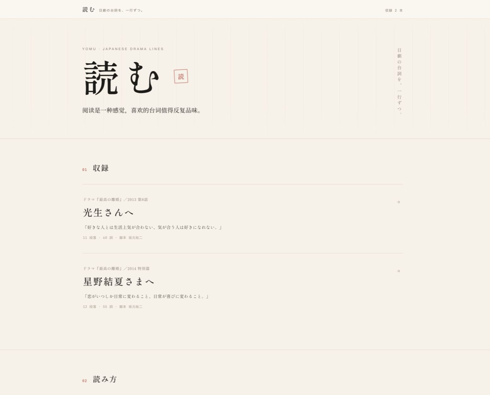
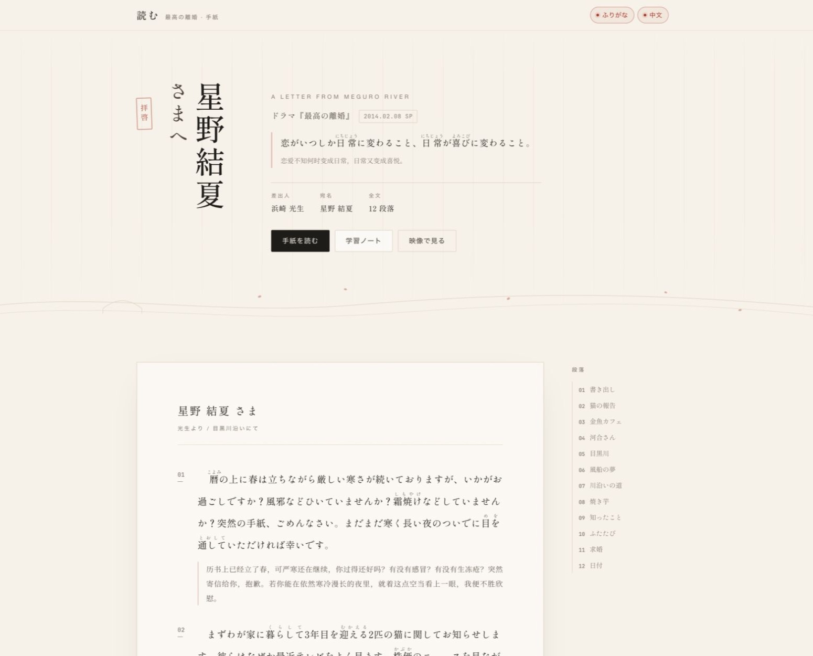

# 読む

日剧台词、书信与独白的精读作品集：原文与译文对照，振假名可选，逐段原声、语法拆解和词汇表放在同一个阅读页里。

[进入作品集](https://akisaya.github.io/yomu/#works) · [阅读一篇](#开始阅读) · [页面能力](#读一篇时可以做什么) · [常见问题](#常见问题)

**読む**把这些难点留在原文旁边。每篇作品从一段台词、书信或独白出发，按原有的停顿和段落排好日文与中文，再把现场声音、句子结构、语法和词汇一层层放回语境。你可以先顺畅地读一遍，也可以停在任意一句，往下看它为什么这样说。

目前收录六篇作品，来自《最高の離婚》《逃げるは恥だが役に立つ》《昼顔》和《ごめんね青春！》。每篇都能在线阅读，也能下载后直接打开。

## 收录作品

| 作品 | 场景 | 这篇在讲什么 |
| --- | --- | --- |
| [あと、ひと駅](nigehaji/index.html) | 《逃げるは恥だが役に立つ》第 6 話 | 温泉旅行归途的列车里，两个人没有说出口的话 |
| [生物の北野です](hirugao/index.html) | 《昼顔》第 11 話 | 离校前的校内广播告别 |
| [光生さんへ](saikou-no-rikon-2/index.html) | 《最高の離婚》第 8 話 | 星野結夏写给浜崎光生的一封未寄出的信 |
| [星野結夏さまへ](saikou-no-rikon/index.html) | 《最高の離婚》2014 特別篇 | 浜崎光生写给前妻的一封信 |
| [今は許しませんけど、乗り越えましょう](gomenne-seishun-9/index.html) | 《ごめんね青春！》第 9 話 | 屋上的自白与告白 |
| [全部、僕の青春なんです](gomenne-seishun-10/index.html) | 《ごめんね青春！》最終話 | 青春祭最后一晚，礼堂舞台上的一整段自白 |

## 开始阅读

打开[在线作品集](https://akisaya.github.io/yomu/)选一篇即可，不需要注册或登录。

建议先开着振假名和中文通读一遍，让耳朵和眼睛回到这一段话的语流里；遇到想细看的句子，再展开下方的精读。已经会读的汉字可以关掉振假名，只想练听力时也可以关掉中文。这两项选择会留在当前浏览器里。

所有阅读页都是自包含 HTML，CSS、脚本和正文收在同一个文件中。下载仓库后，也可以直接双击某篇的 `index.html` 离线阅读。

原文、译文与原声按段落放在一起，精读卡展开后再看句子内部。

## 读一篇时可以做什么

### 既有正文也有拆解

正文按来源的段落或行排列，日文和中文逐段对应。段号既是阅读位置，也是跳转入口；从词汇或精读回到正文时，会直接落回这句话。

### 听这一刻的原声

作品都配有对应场景的日语原声。信纸上的全篇播放条可以拖动进度，每段旁的播放键只播这一段，读到下一段时不会自动串场。某段没有配置原声、或音频加载失败时，页面会回退到浏览器朗读。

### 把一句长句拆开

每段对应一张精读卡，下面分为五层：

- **骨格**：这句由哪些成分搭起来，修饰关系落在哪里。
- **文法**：这一段里值得停下来的句型、省略、呼应、指代和接续；每条都带着原句片段，能跳回正文。
- **語彙**：按出现顺序排好的词，附读音、词性和中文释义。
- **役割**：这一段在整篇里承担什么作用，比如铺垫、反转、回应或收束。
- **訳注**：中文翻译哪里做了取舍，为什么这样译。

文法放在所属段落的卡片里，不需要在正文和另一个语法章节之间来回找。骨格讲结构，文法讲用法，訳注讲中文表达，三者各看一层，不会把同一句话解释三遍。

## 适合怎样使用

- 看剧时遇到一句很喜欢、却没能完全听懂的台词，可以把这篇当作逐句回听和阅读材料。
- 正在学日语，希望把单词、语法和真实语境放在一起，可以顺着「正文 → 原声 → 精读 → 词汇」读。
- 已经读过中文翻译，想看看日文原文的语气、指代和省略，可以关掉中文，回到日文本身。
- 想把喜欢的台词留作离线材料，可以直接保存单篇 HTML；在线站点也支持手机阅读。

## 关于原文和译文

项目中保存了独立的逐段原文与中文译文底稿，以及每篇对应的网页。原文保留来源中的字词、送假名、标点和段落顺序；振假名、精读和词汇只出现在网页展示层。正文、译文和出处之间可以分别核对，不依赖网页文件里的一种排列。

页面中的原文与译文仅供学习研究使用，版权归原作者及各家电视台所有。每篇页脚都会标明作品、集数、脚本家和可供定位的影像时间码。

## 如何新增文章

新增作品、修改译文与精读内容、运行页面校验和发布到作品集的操作说明，集中在 [AGENTS.md](./AGENTS.md)。

## 许可与致谢

阅读页的设计、文字整理与交互代码属于本项目。日剧原文、译文及剧照涉及的原作权利仍归原作者、脚本家和电视台所有。
